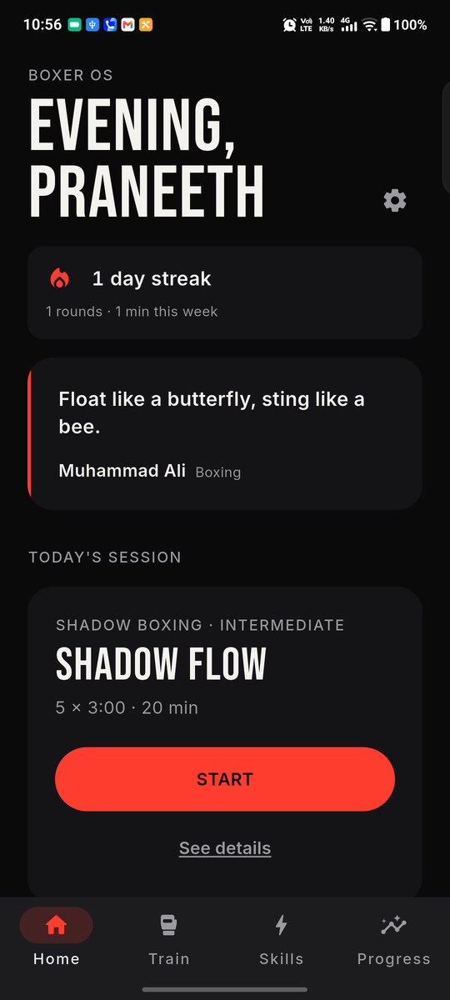
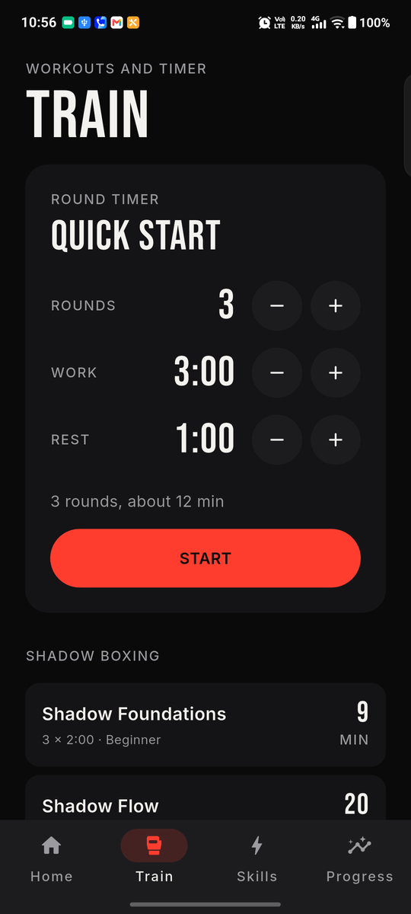
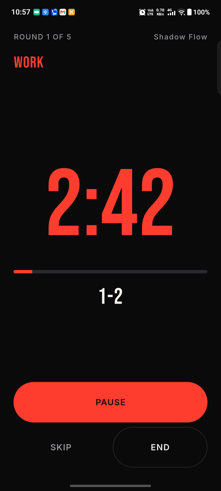
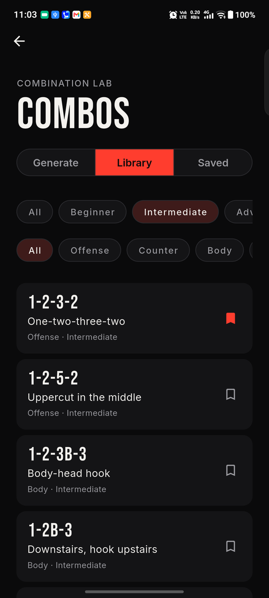
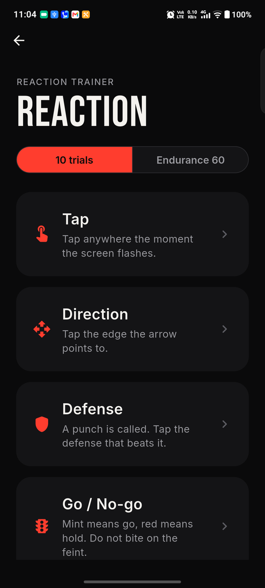
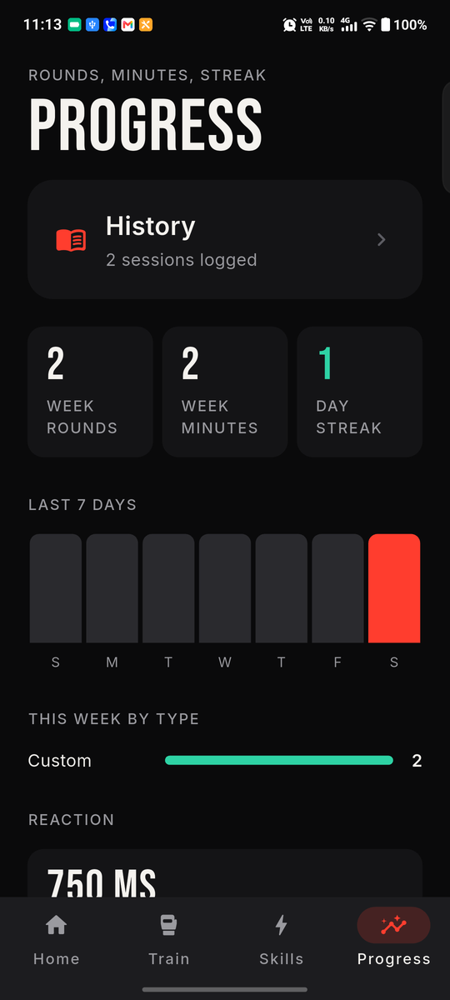

# Boxer OS

Train. Fight. Improve. Repeat.

Boxer OS is a one-stop mobile companion for boxers: your entire boxing journey, in one place.
Rather than a collection of disconnected timers and trackers, it is a lightweight personal
boxing training system that works before, during, after and between sessions.

<p>






</p>

## What it does

- **Plan** - Home recommends today's session or the boxer picks or builds one: training type,
  duration, rounds, goals.
- **Train** - the app runs the rounds with bells, haptics, warnings and visual feedback, and
  delivers spoken prompts without the phone in hand.
- **Improve** - a 60-combination library with a boxing-grammar generator, a reaction trainer
  across four modes, and footwork drills.
- **Track** - rounds, minutes, streak and skill activity update after every session.
- **Analyze** - a weekly snapshot, a 7-day chart, reaction bests and milestone badges.
- **Reflect** - a post-session rating, notes on what worked and what needs work, and full
  session history.

## Local-first

There is no account and no backend: nothing you do in Boxer OS ever leaves your phone. History
and settings live in the app's own storage on the device. Delete the app and the data is gone
with it.

## Install

Requires Flutter 3.41.2 (stable).

```
flutter pub get
flutter run
```

`flutter run` needs a connected Android device or emulator. For a release build:

```
flutter build apk --release
```

See `docs/release.md` for signing an upload build for the Play Console.

## Develop

| Purpose | Command |
|---|---|
| Deps | `flutter pub get` |
| Static analysis | `flutter analyze` |
| Tests | `flutter test` |
| Smoke build | `flutter build apk --debug` |

The `docs/` folder is the project's running memory: `docs/product.md` has the vision and V1
scope, `docs/architecture.md` how the code is put together, `docs/backlog.md` the plan, and
`docs/decisions.md` and `docs/review-log.md` the history of design calls and review findings.
This repo also runs on a tiered agent workflow: an Architect plans and writes handoff packages,
an Opus worker implements each one, and a Sonnet worker writes tests and runs smoke checks;
`/build <goal>` runs that pipeline end to end.

## Status

**Done:** a configurable round timer and 12 guided workouts with bells, haptics and spoken
cues; a 60-combination library with a boxing-grammar generator, bookmarks and practice
sessions; a reaction trainer with Tap, Direction, Defense and Go / No-go modes plus the
Endurance 60 format; footwork drills; session history with ratings and notes; Progress with
streak, weekly chart and milestones; onboarding, quotes and did-you-know facts; a daily
reminder and streak nudge; settings with a voice test.

**Not yet:** move animations, video technique analysis, cloud sync.

## Credits

Fonts: Bebas Neue and Inter, both under the SIL Open Font License (`assets/fonts/OFL-*.txt`).
Bells and beeps are synthesised in-repo, not licensed samples.
