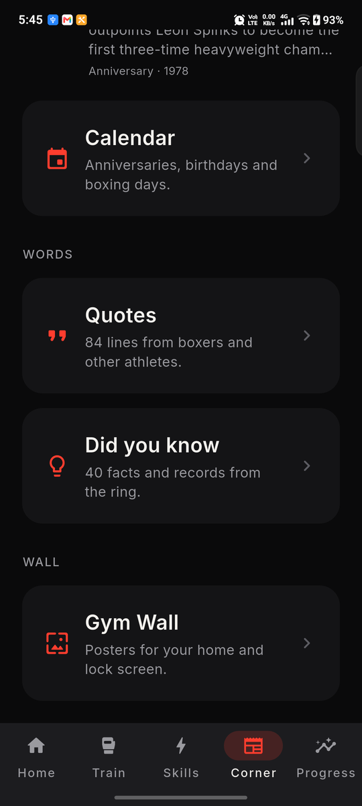

# Boxer OS

Train. Fight. Improve. Repeat.

Boxer OS is a one-stop mobile companion for boxers: your entire boxing journey, in one place.
Rather than a collection of disconnected timers and trackers, it is a lightweight personal
boxing training system that works before, during, after and between sessions.

<p>




</p>

## What it does

- **Plan** - Home recommends today's session or the boxer picks or builds one: training type,
  duration, rounds, goals.
- **Train** - the app runs the rounds with bells, haptics, warnings and visual feedback, and
  delivers spoken prompts without the phone in hand.
- **Improve** - a 60-combination library with a boxing-grammar generator, a reaction trainer
  across four modes, and footwork drills.
- **Track** - rounds, minutes, streak and skill activity update after every session.
- **Analyze** - a weekly snapshot, a 7-day chart, reaction bests and milestone badges.
- **Reflect** - a post-session rating, notes on what worked and what needs work, and full
  session history.

## Local-first

There is no account and no backend: nothing you do in Boxer OS ever leaves your phone. History
and settings live in the app's own storage on the device. Delete the app and the data is gone
with it.

## Install

Requires Flutter 3.41.2 (stable).

```
flutter pub get
flutter run
```

`flutter run` needs a connected Android device or emulator. For a release build:

```
flutter build apk --release
```

See `docs/release.md` for signing an upload build for the Play Console.

## Develop

| Purpose | Command |
|---|---|
| Deps | `flutter pub get` |
| Static analysis | `flutter analyze` |
| Tests | `flutter test` |
| Smoke build | `flutter build apk --debug` |

## Project memory

The repo carries its own memory so that nobody, human or AI assistant, has to re-read the
codebase to find out where things stand. Two folders, and they are the first thing to read:

| Folder | Layer | Holds |
|---|---|---|
| `memory/` | running memory | `current.md` (what is in flight right now), `log.md` (dated entries, newest first), `notes/` (one topic per file: gotchas, device behaviour, dead ends, open questions). Anyone may write here. |
| `docs/` | settled knowledge | `product.md` (vision and V1 scope), `architecture.md` (how the code is put together), `backlog.md` (the plan), `decisions.md` and `review-log.md` (design calls and review findings), `release.md` (signing and Play checklist). |

The split is simple: `memory/` is what is still moving, `docs/` is what has stopped moving. A
memory entry that has settled gets promoted into the matching `docs/` file and deleted from
`memory/`, so a fact only ever lives in one place.

**Before you start:** read `memory/current.md` and the last few entries of `memory/log.md`, then
`docs/product.md` and `docs/architecture.md`, then your tool's conventions file.

**When you finish:** rewrite `memory/current.md`, add an entry to `memory/log.md`, update
`docs/architecture.md` if the structure changed, and mark the backlog item done. Leave the
change unstaged; the owner reviews and commits.

`docs/README.md` has the full protocol and the reading order. It is written for any assistant
(Claude Code, Codex, an editor agent) or any human; tool-specific wiring lives in `.claude/`
and `.codex/`.

## Codex

Open this repository in Codex, or run `codex` from its root. `AGENTS.md` points to the shared
instructions and memory; `.codex/config.toml` provides project defaults for sandboxing and
approvals. Model selection stays in your personal settings. See [.codex/README.md](.codex/README.md)
for setup details.

## Agent workflow (Claude Code)

This repo also runs on a tiered agent workflow: an Architect plans and writes handoff packages
under `.claude/handoffs/`, an Opus worker implements each one, and a Sonnet worker writes tests
and runs smoke checks; `/build <goal>` runs that pipeline end to end. Conventions, commands and
the tier rules are in `.claude/CLAUDE.md`. Using a different assistant is fine: read
`.claude/CLAUDE.md` for the coding conventions, and follow the memory protocol above.

## Status

**Done:** a configurable round timer and 12 guided workouts with bells, haptics and spoken
cues; a 60-combination library with a boxing-grammar generator, bookmarks and practice
sessions; a reaction trainer with eight modes (Tap, Direction, Defense, Go / No-go,
Peripheral, Colour call, Sequence, Sound) plus the Endurance 60 format; ten footwork drills;
session history with ratings and notes; Progress with streak, weekly chart and milestones;
the Corner tab with twelve Legends stories with archive photo galleries, a boxing calendar, a
library of 84 quotes and 40 facts, and Gym Wall: 148 posters (taglines, legends, archive moments, inspiration, quotes) for the
home and lock screen, with a live wallpaper that shows the next one every time the screen wakes; onboarding; daily, streak and boxing-day reminders; settings with a voice test and
an About screen.

**Not yet:** move animations, video technique analysis, cloud sync.

## Credits

Fonts: Bebas Neue and Inter, both under the SIL Open Font License (`assets/fonts/OFL-*.txt`).
Bells and beeps are synthesised in-repo, not licensed samples.

## License

Boxer OS is released under the PolyForm Noncommercial License 1.0.0 (see `LICENSE`). You can
use, copy, modify and share it for noncommercial purposes provided the license notice and
attribution to Praneeth Reddy stay with the code. Commercial use requires written permission
from the author. Third-party content: fonts under the SIL OFL; legend photographs from
Wikimedia Commons under their listed licenses (see the About screen).
